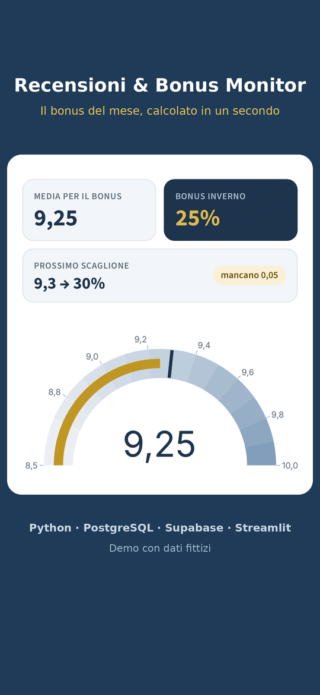
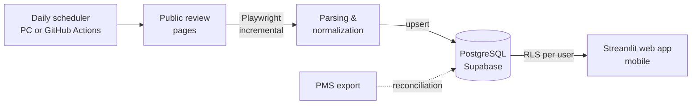
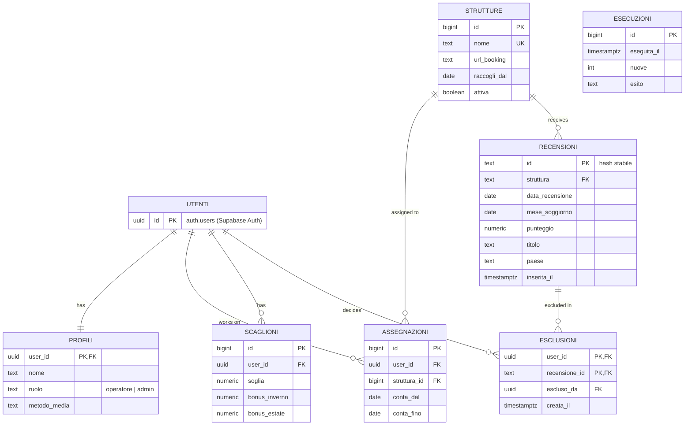

# ⭐ Reviews & Bonus Monitor

**End-to-end data pipeline and mobile web app to track guest reviews and the tiered bonus of hospitality staff.**

🇮🇹 [Versione italiana](README.md)

[▶ Live demo (fictitious data)](https://bonus-monitor-demo.streamlit.app/) · [🎥 Video](https://youtube.com/shorts/NblzpOS2NUs) · Python · PostgreSQL · Supabase · Streamlit

> The demo uses **entirely made-up data** (properties, guests, reviews) and requires no login.
> The app interface is in Italian.

<a href="https://youtube.com/shorts/NblzpOS2NUs"></a>

*🎥 Demo video (about 1 min 45 s)*

---

## The problem

A property management company in Rome pays its staff a **seasonal tiered bonus** based on the average review score of the properties they manage. The calculation was done by hand and the numbers were hard to verify:

- reviews received **before** the staff member started, or for stays during their days off;
- **different calculation methods** (average of property averages vs. average of all reviews);
- **different tiers in winter and summer**.

## The solution

| Stage | What it does | Tech |
|---|---|---|
| **Extract** | Automated, **incremental** collection of public reviews: resumes from the last stored review and stops at the first page with nothing new | Python, Playwright, BeautifulSoup |
| **Transform** | Parsing (Italian dates, scores, stay month), stable hash IDs for deduplication, normalization | Python, pandas |
| **Load** | Upsert into PostgreSQL with a run log | Supabase (PostgreSQL + REST API) |
| **Model & Security** | Multi-user model with **Row Level Security**: each staff member sees only their properties, the admin sees everything | SQL, RLS policies |
| **Serve** | Mobile web app with login: bonus gauge, monthly trend, exclusions, simulator | Streamlit, Plotly |



## Features

- 🔐 **Multi-user login** (staff and admin), no public sign-up.
- 🎯 **Seasonal bonus tiers**: winter (Nov 1 – Mar 31) and summer (Apr 1 – Oct 31), configurable per staff member.
- 🏎️ **Gauge** with one segment per tier: the gold bar is the current average, the blue line the next tier's threshold.
- 📅 **Monthly trend** over 12 fixed months, with chart and summary; in the Reviews section each month expands like a pivot table to show its reviews (date, stay month, score, guest).
- ✅ **Review exclusion** for reviews not attributable to the staff member (e.g. stays during days off or before they started): tick several, then a single "Apply & recalculate", stored in the database.
- 🧪 **What-if simulator** with up to 10 hypothetical scores, including from other properties, to estimate average and bonus.
- 🧮 Two averaging methods: **average of properties** or **all reviews together** (the one the company uses).

## Technical highlights

- **Incremental loading**: after the initial backfill, each run reads about one page per property (7-day safety margin for late-published reviews).
- **Security in the database, not in the app**: the app only holds the public key; what each user can read or write is enforced by PostgreSQL RLS policies.
- **Configuration as data**: new properties, staff, start dates and tiers are added through tables, with no code changes.
- **One codebase for production and demo**: without Supabase secrets the app starts in demo mode, backed by an in-memory database exposing the same interface (`dati_demo.py`).
- **Data reconciliation**: comparing the app with the company's figures and the PMS export revealed the causes of the discrepancies (calculation method, reviews from other properties, out-of-period stays), which were then handled in the model.

## Data model



Every table has **Row Level Security** enabled: an operator can only read reviews of the properties assigned to them and only write their own exclusions. `esecuzioni` logs every scraper run. Some descriptive columns of `recensioni` are omitted from the diagram.

## Repository layout

```
app/                 Streamlit web app
  streamlit_app.py   UI (production + demo)
  logica.py          calculations: periods, averages, seasonal tiers, monthly trend
  supa.py            Supabase client (login, reads and writes with the user's token)
  dati_demo.py       fictitious data and in-memory database for the demo
scraper/             review collection and loading
  booking_reviews.py incremental scraping (Playwright) and local CSV + Excel mode
  archivio.py        Supabase or CSV storage
  crea_excel.py      Excel report with dashboard (local mode)
supabase/            SQL schema, RLS policies, user setup scripts
docs/                example GitHub Actions workflow for the daily run
```

## Run it locally

```bash
pip install -r app/requirements.txt
streamlit run app/streamlit_app.py      # starts in demo mode when no secrets are set
```

For the full version: run `supabase/schema.sql` and `supabase/esclusioni.sql` on a Supabase project, set up users with `supabase/aggiungi_utente.sql`, and add `SUPABASE_URL` and `SUPABASE_PUBLISHABLE_KEY` to `app/.streamlit/secrets.toml` (see `secrets.toml.esempio`).

## Notes

- Built for a real need. All data published here and in the demo is **fictitious**: no real guests, staff or company data.
- Automated collection should be used responsibly and in line with each platform's terms of use (low frequency, only the data needed).

## Author

**Davide Buccino** · Data Analyst · Rome
[LinkedIn](https://www.linkedin.com/in/davide-buccino) · [Portfolio](https://sites.google.com/view/davide-buccino/)
