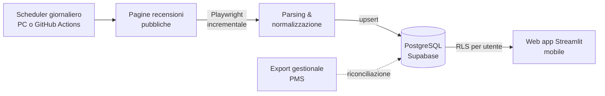

# ⭐ Recensioni & Bonus Monitor

**Pipeline dati end-to-end e web app mobile per il monitoraggio delle recensioni e del bonus a scaglioni degli operatori di strutture ricettive.**

🇬🇧 [English version](README.en.md)

[▶ Demo live (dati fittizi)](https://bonus-monitor-demo.streamlit.app/) · [🎥 Video](https://youtube.com/shorts/7IBAIAJx0p8) · Python · PostgreSQL · Supabase · Streamlit

> La demo usa **dati completamente inventati** (strutture, ospiti, recensioni) e non richiede credenziali.

<a href="https://youtube.com/shorts/7IBAIAJx0p8"></a>

*🎥 Video della demo (circa 1 minuto e 45 secondi)*

---

## Il problema

Una società di gestione di strutture ricettive a Roma riconosce ai propri operatori un **bonus a scaglioni stagionali**, calcolato sulla media delle recensioni ricevute nelle strutture che seguono. Il calcolo era fatto a mano e i numeri erano difficili da verificare:

- recensioni ricevute **prima** dell'arrivo dell'operatore, o relative a soggiorni in cui era in ferie;
- **metodi di calcolo diversi** (media delle strutture vs media di tutte le recensioni);
- scaglioni **diversi tra inverno ed estate**.

## La soluzione

| Fase | Cosa fa | Tecnologie |
|---|---|---|
| **Extract** | Raccolta automatizzata delle recensioni pubbliche, **incrementale**: riparte dall'ultima recensione salvata e si ferma alla prima pagina senza novità | Python, Playwright, BeautifulSoup |
| **Transform** | Parsing (date in italiano, punteggi, mese di soggiorno), ID stabile per la deduplica, normalizzazione | Python, pandas |
| **Load** | Upsert su PostgreSQL con registro delle esecuzioni | Supabase (PostgreSQL + API REST) |
| **Model & Security** | Modello multi-utente con **Row Level Security**: ogni operatore vede solo le sue strutture, l'admin vede tutto | SQL, RLS policies |
| **Serve** | Web app mobile con login: contagiri del bonus, andamento mensile, esclusioni, simulatore | Streamlit, Plotly |



## Funzionalità

- 🔐 **Login multi-utente** (operatori e amministratore), nessuna registrazione libera.
- 🎯 **Bonus a scaglioni stagionali**: inverno (1 nov – 31 mar) ed estate (1 apr – 31 ott), configurabili per ogni operatore.
- 🏎️ **Contagiri** sfumato dal rosso al verde, uno spicchio per scaglione, con la media attuale e il prossimo obiettivo.
- 📅 **Andamento mensile** su 12 mesi fissi: ogni mese si apre come una pivot e mostra le sue recensioni (data, mese di soggiorno, voto, ospite).
- ✅ **Esclusione di recensioni** non imputabili all'operatore (es. soggiorni durante ferie o prima del suo arrivo): più spunte e un solo "Applica e ricalcola", salvate nel database.
- 🧪 **Simulatore** fino a 10 voti ipotetici, anche da altre strutture, per stimare media e bonus.
- 🧮 Due metodi di media: **media delle strutture** oppure **tutte le recensioni insieme** (quello usato dall'azienda).

## Scelte tecniche interessanti

- **Caricamento incrementale**: dopo il primo caricamento storico, ogni esecuzione legge in media una sola pagina per struttura (margine di 7 giorni per le recensioni pubblicate in ritardo).
- **Sicurezza nel database, non nell'app**: l'app usa solo la chiave pubblica; cosa può leggere o scrivere ogni utente lo decidono le policy RLS di PostgreSQL.
- **Configurazione nei dati**: nuove strutture, operatori, date di inizio e scaglioni si aggiungono da tabelle, senza modificare il codice.
- **Stesso codice per produzione e demo**: senza segreti Supabase l'app parte in modalità demo, con un database in memoria che imita la stessa interfaccia (`dati_demo.py`).
- **Riconciliazione dei dati**: il confronto con i conteggi aziendali e con l'export del gestionale (PMS) ha fatto emergere le cause delle discrepanze (metodo di calcolo, recensioni di altre strutture, soggiorni fuori periodo), poi gestite nel modello.

## Modello dati

```
strutture ──< assegnazioni >── utenti (auth.users) ──< profili
    │              (conta_dal, conta_fino)      │
    └──< recensioni >──< esclusioni >───────────┘
                                   utenti ──< scaglioni (soglia, bonus_inverno, bonus_estate)
esecuzioni (registro dello scraper)
```

## Struttura del repository

```
app/                 web app Streamlit
  streamlit_app.py   interfaccia (produzione + demo)
  logica.py          calcoli: periodi, medie, scaglioni stagionali, andamento mensile
  supa.py            client Supabase (login, letture e scritture con token utente)
  dati_demo.py       dati fittizi e database in memoria per la demo
scraper/             raccolta e caricamento delle recensioni
  booking_reviews.py scraping incrementale (Playwright) e modalità locale CSV + Excel
  archivio.py        archivio Supabase o CSV
  crea_excel.py      report Excel con dashboard (modalità locale)
supabase/            schema SQL, policy RLS, script di configurazione utenti
docs/                esempio di workflow GitHub Actions per l'esecuzione giornaliera
```

## Provarlo in locale

```bash
pip install -r app/requirements.txt
streamlit run app/streamlit_app.py      # senza segreti parte in modalità demo
```

Per la versione completa: eseguire `supabase/schema.sql` e `supabase/esclusioni.sql` su un progetto Supabase, configurare gli utenti con `supabase/aggiungi_utente.sql` e aggiungere `SUPABASE_URL` e `SUPABASE_PUBLISHABLE_KEY` in `app/.streamlit/secrets.toml` (vedi `secrets.toml.esempio`).

## Note

- Progetto nato per un'esigenza reale. I dati pubblicati qui e nella demo sono **fittizi**: nessun dato di ospiti, operatori o aziende reali.
- La raccolta automatizzata va usata in modo responsabile e nel rispetto dei termini d'uso delle piattaforme (bassa frequenza, solo dati necessari).

## Autore

**Davide Buccino** · Data Analyst · Roma
[LinkedIn](https://www.linkedin.com/in/davide-buccino) · [Portfolio](https://sites.google.com/view/davide-buccino/)
